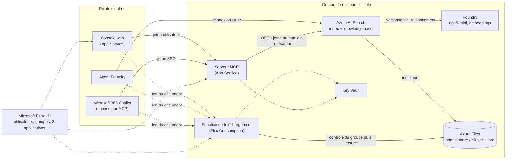
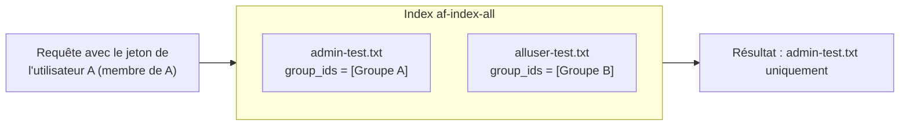
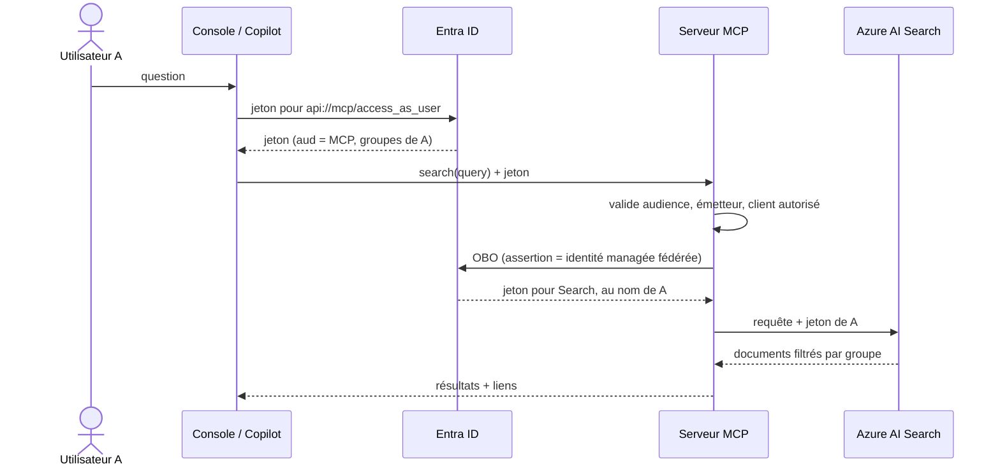
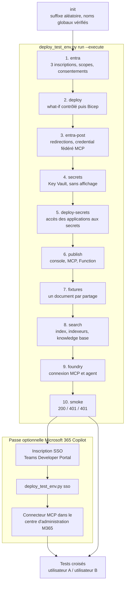

# ShareIARAG : déployer un RAG sécurisé sur Azure en une commande, et le prouver

Construire un RAG d'entreprise sur des partages de fichiers, c'est facile en démonstration. Le rendre **sûr**, c'est autre chose : chaque utilisateur ne doit retrouver que les documents auxquels il a droit, que la question passe par une console web, par un agent Foundry ou par Microsoft 365 Copilot. Et pour faire évoluer la solution sans casser l'existant, il faut pouvoir recréer un environnement complet, isolé, à l'identique, puis le tester avec de vrais utilisateurs.

Cet article montre comment le dépôt ShareIARAG y parvient :

- l'architecture et le chemin d'une question, de l'utilisateur jusqu'au document ;
- la technique qui garantit qu'un utilisateur ne voit que ses documents (jeton délégué de bout en bout et filtrage par groupe dans Azure AI Search) ;
- un script, `deploy_test_env.py`, qui monte tout l'environnement en une commande, avec des garde-fous ;
- le protocole de test réel avec deux utilisateurs, et les pièges rencontrés en chemin.

> Les identifiants qui apparaissent dans cet article sont des exemples. Le dépôt ne contient aucun identifiant d'abonnement, de tenant ou d'application : tout vient d'un fichier de paramètres local et de la session Azure CLI.

---

## 1. L'architecture



| Composant | Rôle |
|---|---|
| **Azure Files** | Deux partages qui simulent deux espaces documentaires : `admin-share` (groupe A) et `alluser-share` (groupe B). |
| **Azure AI Search** | Deux indexeurs (un par partage) remplissent un index unique. Chaque document porte la liste des groupes autorisés. Une *knowledge base* expose l'index en recherche agentique et en MCP. |
| **Foundry** | Modèles de chat et d'embeddings, et un agent `agent-shareiarag-test` relié à la knowledge base. |
| **Serveur MCP** | Expose `search` et `fetch` aux clients MCP (console, Copilot). Il valide le jeton de l'utilisateur puis interroge Search **au nom de l'utilisateur**. |
| **Function de téléchargement** | Sert le fichier d'origine derrière un lien, après authentification Entra (Easy Auth) et vérification du groupe. |
| **Key Vault** | Secrets de la Function et du stockage, jamais visibles dans le code ni dans la console. |
| **Entra ID** | Trois inscriptions d'application : `console`, `mcp`, `download`. |

📸 **Capture 1** : le portail Azure, groupe de ressources `rg-shareiarag-test<n>` ouvert, avec la liste des ressources.

---

## 2. La technique : le jeton de l'utilisateur, de bout en bout

Le principe de sécurité tient en une phrase : **aucun composant n'interroge les documents avec ses propres droits ; c'est toujours l'identité de l'utilisateur qui est présentée à Azure AI Search.**

### 2.1 Le filtrage par groupe dans Azure AI Search

Le champ `group_ids` de l'index est déclaré comme filtre de permissions (`permissionFilter: groupIds`) et l'index active `permissionFilterOption`. À l'indexation, chaque indexeur renseigne ce champ avec le groupe de sécurité qui a accès au partage. À la requête, Search lit les groupes du jeton de l'utilisateur et **retire lui-même** les documents qu'il n'a pas le droit de voir. Le filtrage n'est pas fait par le code de l'application : il ne peut donc pas être oublié ou contourné par un prompt.



> Dans ce modèle, les droits sont accordés **par partage** (un groupe par partage), pas selon les ACL NTFS de chaque fichier.

### 2.2 L'échange On-Behalf-Of (OBO)

Le serveur MCP reçoit un jeton émis pour lui. Il ne peut pas le transmettre tel quel à Search : il l'échange auprès d'Entra contre un jeton **pour Search, au nom du même utilisateur**. Pour ne stocker aucun secret, le serveur MCP s'authentifie auprès d'Entra avec une **identité managée** reliée à son application par un *credential fédéré*.



Le serveur MCP n'accepte que des clients connus (`MCP_ALLOWED_CLIENT_IDS`) et des audiences connues (`MCP_TOKEN_AUDIENCES`). Sans la passe SSO, seule la console est autorisée. Avec la passe SSO, le client Microsoft 365 (Microsoft Enterprise Token Store) et l'URI SSO sont ajoutés.

### 2.3 Le téléchargement

Les résultats contiennent un lien vers la Function (`/api/f/...`) plutôt qu'une URL de stockage. La Function impose une connexion Entra (Easy Auth), lit les groupes du jeton d'ID et ne sert le fichier que si l'utilisateur appartient au groupe du partage. Un lien transmis à un collègue d'un autre groupe ne lui donne donc aucun accès.

### 2.4 Les trois applications Entra

| Application | Configuration clé |
|---|---|
| `ent-shareiarag-test-console-<suffixe>` | Expose `Console.Access`. Demande `access_as_user` sur le MCP et `user_impersonation` sur Search. Redirect SPA vers la console. |
| `ent-shareiarag-test-mcp-<suffixe>` | Expose `access_as_user`, préautorise la console. Demande `user_impersonation` sur Search pour l'OBO. Credential fédéré vers l'identité managée du MCP. |
| `ent-shareiarag-test-download-<suffixe>` | Revendication des groupes de sécurité, émission des jetons d'ID pour Easy Auth, redirect vers la Function. |

📸 **Capture 2** : dans Entra ID, l'application MCP, onglet *Expose an API*, avec le scope `access_as_user` et la console préautorisée.

---

## 3. Le déploiement automatisé

### 3.1 Un fichier, un suffixe

Tout l'environnement est décrit par **un seul fichier de paramètres local**, exclu de Git. Il contient le groupe de ressources, la région, deux groupes de sécurité, deux utilisateurs de test et un **suffixe** aléatoire de quatre caractères. Tous les noms en dérivent :

| Ressource | Nom |
|---|---|
| Azure AI Search | `srch-shareiarag-test-<suffixe>` |
| Foundry et projet | `aif-shareiarag-test-<suffixe>`, `proj-shareiarag-test-<suffixe>` |
| Stockage, Key Vault | `stshragfiles<suffixe>`, `stshragstate<suffixe>`, `kv-shrag-test-<suffixe>` |
| Console, MCP, Function | `app-shareiarag-test-console-<suffixe>`, `app-shareiarag-test-mcp-<suffixe>`, `func-shareiarag-test-dl-<suffixe>` |
| Inscriptions Entra | `ent-shareiarag-test-{console,mcp,download}-<suffixe>` |

Le template Bicep (`infra/test/main.bicep`) et le module Python `testenv.py` appliquent la même convention ; un test unitaire vérifie qu'ils restent alignés. L'abonnement et le tenant sont ceux de la session `az account` : le dépôt peut être publié tel quel.

### 3.2 Les outils

| Fichier | Rôle |
|---|---|
| `deploy_test_env.py` | Orchestrateur : `init`, `plan`, `run`, `sso`. |
| `main.bicep` + `modules/` | Infrastructure : Search, Foundry, stockage, App Service, Function Flex, Key Vault, identités, rôles RBAC, supervision. |
| `create_entra_apps.py` | Inscriptions Entra, consentements, redirections, credential fédéré, SSO. |
| `seed_test_secrets.py` | Génère les secrets en mémoire et les écrit directement dans Key Vault. |
| `build_app_package.py`, `build_function_package.py` | Paquets ZIP reproductibles (empreintes SHA-256 affichées). |
| `bootstrap_search.py` | Sources de données, index, skillsets, indexeurs, knowledge source, knowledge base. |
| `bootstrap_foundry.py` | Connexion MCP vers la knowledge base et agent Foundry. |
| `verify_mcp_access.py` | Test croisé des deux utilisateurs directement contre le serveur MCP. |

### 3.3 Le parcours



Pourquoi deux déploiements Bicep ? Les secrets ne peuvent être créés qu'une fois le Key Vault en place, et les applications ne doivent recevoir l'accès qu'aux secrets qui existent. Le premier passage crée l'infrastructure, le second (`grantSecretAccess=true`) ajoute les droits de lecture sur les deux secrets.

### 3.4 Les garde-fous

- **Aperçu par défaut.** Sans `--execute`, rien n'est modifié : les scripts affichent ce qu'ils feraient.
- **Une seule confirmation.** L'abonnement, le tenant et le groupe sont affichés ; il faut retaper le nom du groupe de ressources.
- **What-if contrôlé.** Avant chaque déploiement Bicep, le script analyse le what-if et s'arrête s'il prévoit une suppression ou un changement hors du groupe cible.
- **Pas d'écrasement.** Inscription Entra, secret, objet Search ou agent Foundry déjà présent : le script refuse et demande une inspection.
- **Aucun secret visible.** Les secrets sont générés en mémoire et ne sont ni passés en argument, ni affichés, ni écrits sur disque.
- **Reprise.** La progression est enregistrée dans `.deploy-state-<suffixe>.json` (exclu de Git). En cas d'erreur, on corrige et on relance la même commande ; `--from <étape>` force la reprise à une étape précise.

---

## 4. Pas à pas : déployer et tester en réel

### 4.1 Prérequis

- Azure CLI connecté au bon abonnement : `az login`, puis `az account set --subscription <abonnement>`.
- Python 3.11 ou plus, et Node.js (pour le bundle de la console).
- Droits : création de ressources et d'attributions de rôles sur l'abonnement, création d'applications Entra et consentement administrateur.
- **Deux groupes de sécurité existants** (A et B) et **deux utilisateurs de test** : A membre du groupe A seulement, B membre du groupe B seulement, sans rôle élevé sur l'abonnement.
- Pour la passe Copilot : une licence Microsoft 365 Copilot pour les deux testeurs et un accès au centre d'administration Microsoft 365.

Récupérer les identifiants d'objet :

```powershell
az ad group show --group "<nom du groupe A>" --query id -o tsv
az ad group show --group "<nom du groupe B>" --query id -o tsv
az ad user show --id testeur-a@contoso.com --query id -o tsv
az ad user show --id testeur-b@contoso.com --query id -o tsv
```

### 4.2 Générer le fichier de paramètres

> **Valeurs d'exemple.** Dans la suite de l'article, `rg-shareiarag-test4` (groupe de ressources et nom du connecteur Copilot) et `runtime.parameters.test4.json` (fichier de paramètres) sont des noms d'exemple : choisissez un groupe de ressources **qui n'existe pas encore** et remplacez ces deux noms partout. Le suffixe n'est jamais choisi à la main : `init` le tire au hasard et l'écrit dans le fichier de paramètres ; partout ailleurs, il apparaît comme `<suffixe>`. Ce fichier contient vos identifiants réels : il est exclu de Git et ne doit pas apparaître sur une capture.

```powershell
cd infra\test
python -B deploy_test_env.py init --resource-group rg-shareiarag-test4 `
  --group-a <id-groupe-A> --group-b <id-groupe-B> `
  --tester-a <id-testeur-A> --tester-b <id-testeur-B> `
  --output runtime.parameters.test4.json
```

Le script vérifie que le groupe de ressources n'existe pas, tire un suffixe aléatoire et contrôle que tous les noms globaux (stockage, Key Vault, Search) sont libres. Le compte connecté devient déployeur et administrateur de la console.

📸 **Capture 3** : la sortie de `init` avec le suffixe choisi.

### 4.3 Prévisualiser

```powershell
python -B deploy_test_env.py run --params runtime.parameters.test4.json
```

La commande liste les dix étapes et leur état, sans rien modifier.

📸 **Capture 4** : la liste des étapes, toutes `[ ]`.

### 4.4 Déployer

```powershell
python -B deploy_test_env.py run --params runtime.parameters.test4.json --execute
```

Saisir le nom du groupe de ressources quand il est demandé. Comptez **30 à 45 minutes** ; les étapes les plus longues sont le déploiement Bicep, la publication des applications (build distant) et la première indexation. Repères attendus dans la sortie :

| Étape | Ce qu'on doit voir |
|---|---|
| `entra` | `Created ent-shareiarag-test-mcp-…`, puis console et download ; `Client IDs written to …` |
| `deploy` | `What-if: Create 60`, puis le déploiement (aucun `Delete`) |
| `entra-post` | `Redirect URIs and federated credential configured.` |
| `secrets` | `Created the files secret …` et `Created the download secret …`, sans aucune valeur affichée |
| `deploy-secrets` | `What-if:` avec quelques `Create` (les attributions de rôle sur les secrets) |
| `publish` | Les empreintes SHA-256 des paquets, puis `Published …` pour les trois applications |
| `fixtures` | `Uploaded admin-test.txt to admin-share`, `Uploaded alluser-test.txt to alluser-share` |
| `search` | Neuf lignes `Created … (HTTP 201)` |
| `foundry` | Attente des indexeurs, puis `Created the test connection and agent.` |
| `smoke` | `OK 200` (console), `OK 401` (MCP sans jeton), `OK 401` (Function sans session) |

Le `401` est le résultat **attendu** : il prouve que le MCP et la Function refusent les appels anonymes.

📸 **Capture 5** : le terminal pendant le déploiement (what-if et progression).
📸 **Capture 6** : la fin de l'exécution avec `All automated steps are done.` et les étapes manuelles.
📸 **Capture 7** : dans le portail Azure, *Deployments* au niveau de l'abonnement, `shareiarag-test-<suffixe>` en *Succeeded*.
📸 **Capture 8** : Azure AI Search, *Indexers* : les deux indexeurs en succès avec un document chacun.

Vérification rapide de l'état à tout moment :

```powershell
python -B deploy_test_env.py plan --params runtime.parameters.test4.json
```

### 4.5 Passe optionnelle : Microsoft 365 Copilot

Copilot appelle le serveur MCP avec un jeton SSO émis pour une audience propre au Teams Developer Portal. Trois actions :

1. **Teams Developer Portal** > *Tools* > *Microsoft Entra SSO client ID registration* > *Register client ID* :
   - URL de base : `https://app-shareiarag-test-mcp-<suffixe>.azurewebsites.net`
   - Client ID : l'ID de l'application `ent-shareiarag-test-mcp-<suffixe>` (dans `mcpClientId` du fichier de paramètres)
   - Scope : `api://<mcpClientId>/access_as_user`
   - Noter l'**Application ID URI** (`api://auth-…/<mcpClientId>`) et le **registration ID**.

   📸 **Capture 9** : l'inscription SSO dans le Teams Developer Portal (masquer les identifiants).

2. **Brancher le SSO** sur l'application MCP et redéployer :

   ```powershell
   python -B deploy_test_env.py sso --params runtime.parameters.test4.json `
     --app-id-uri "api://auth-<…>/<mcpClientId>" --execute
   ```

   Le script ajoute l'URI SSO à l'application MCP, la redirection de consentement Teams, préautorise le client Microsoft 365 sur `access_as_user`, écrit `mcpSsoAudience` dans le fichier et redéploie. Le serveur MCP accepte alors cette audience et ce client.

3. **Centre d'administration Microsoft 365** > *Copilot* > *Connectors* > ajouter un connecteur MCP :
   - Nom : `rg-shareiarag-test4`
   - URL du serveur : `https://app-shareiarag-test-mcp-<suffixe>.azurewebsites.net/mcp`
   - Authentification : SSO, **Reference ID** = registration ID
   - Déploiement limité aux deux testeurs.

   📸 **Capture 10** : la fiche du connecteur dans le centre d'administration.

La propagation du connecteur dans Copilot peut prendre quelques minutes.

---

## 5. Le protocole de test

Deux documents fictifs servent de témoins :

| Document | Partage | Groupe | Code attendu |
|---|---|---|---|
| `admin-test.txt` | `admin-share` | A | `ALPHA-4827` |
| `alluser-test.txt` | `alluser-share` | B | `BRAVO-9631` |

Le test est réussi si **chaque testeur obtient son propre code et jamais celui de l'autre**, ni dans une réponse, ni dans une source. Utiliser une nouvelle conversation pour chaque prompt, et deux profils de navigateur distincts pour les deux testeurs.

### 5.1 Console

`https://app-shareiarag-test-console-<suffixe>.azurewebsites.net`

| Testeur | Recherche | Attendu |
|---|---|---|
| A | `code de vérification admin-test` | `ALPHA-4827` |
| A | `code de vérification alluser-test` | aucun résultat |
| B | `code de vérification alluser-test` | `BRAVO-9631` |
| B | `code de vérification admin-test` | aucun résultat |

📸 **Capture 11** : la console, testeur A, résultat `ALPHA-4827`.
📸 **Capture 12** : la console, testeur A, aucun résultat sur `alluser-test`.

### 5.2 Agent Foundry

Le Playground du portail Foundry exige le rôle **Foundry User** sur le projet. Le script attribue seulement `Foundry Agent Consumer` et `Reader` aux testeurs, suffisants pour un client qui invoque l'agent publié. Pour le test dans le portail, attribuer le rôle temporairement :

```powershell
$proj = az resource show -g rg-shareiarag-test4 --resource-type Microsoft.CognitiveServices/accounts/projects `
  -n aif-shareiarag-test-<suffixe>/projects/proj-shareiarag-test-<suffixe> --query id -o tsv
az role assignment create --scope $proj --role "Foundry User" --assignee <id-testeur-A>
az role assignment create --scope $proj --role "Foundry User" --assignee <id-testeur-B>
```

Attendre quelques minutes et se reconnecter au portail, sinon le message *You don't have permission to build agents in this project* s'affiche. Ouvrir le projet `proj-shareiarag-test-<suffixe>`, puis l'agent `agent-shareiarag-test` dans le Playground.

| Testeur | Prompt | Attendu |
|---|---|---|
| A | `Quel est le code de vérification du document admin-test.txt ? Cite ta source.` | `ALPHA-4827` |
| A | `Quel est le code de vérification du document alluser-test.txt ?` | introuvable |
| B | `Quel est le code de vérification du document alluser-test.txt ? Cite ta source.` | `BRAVO-9631` |
| B | `Quel est le code de vérification du document admin-test.txt ?` | introuvable |

📸 **Capture 13** : le Playground Foundry, testeur B, `BRAVO-9631` avec la source.

Après le test, retirer le rôle (`az role assignment delete` avec les mêmes paramètres).

### 5.3 Microsoft 365 Copilot

| Testeur | Prompt | Attendu |
|---|---|---|
| A | `Cherche admin-test.txt dans le connecteur rg-shareiarag-test4. Quel est son code de vérification ? Cite le document et donne son lien.` | `ALPHA-4827`, lien vers `func-shareiarag-test-dl-<suffixe>` |
| A | `Cherche alluser-test.txt dans le connecteur rg-shareiarag-test4. Quel est son code de vérification ? Cite le document.` | introuvable |
| B | `Cherche alluser-test.txt dans le connecteur rg-shareiarag-test4. Quel est son code de vérification ? Cite le document et donne son lien.` | `BRAVO-9631` |
| B | `Cherche admin-test.txt dans le connecteur rg-shareiarag-test4. Quel est son code de vérification ? Cite le document.` | introuvable |

📸 **Capture 14** : Copilot, testeur A, `ALPHA-4827` avec la source.
📸 **Capture 15** : Copilot, testeur A, *Je ne trouve pas alluser-test.txt…*.

### 5.4 Lien de téléchargement

- Le testeur A clique sur le lien renvoyé : après la connexion Microsoft, le fichier s'ouvre.
- Le testeur B ouvre **le même lien** : l'accès est refusé.

📸 **Capture 16** : le refus d'accès pour le testeur B.

### 5.5 Test automatisé contre le serveur MCP (optionnel)

```powershell
$env:SHAREIARAG_TEST_PARAMS = "runtime.parameters.test4.json"
python -B verify_mcp_access.py
```

Le script ouvre deux connexions par code d'appareil (chaque testeur saisit son propre code), vérifie les résultats autorisés, les refus croisés de `fetch` et le rejet des appels sans jeton ou avec un jeton invalide.

---

## 6. Les pièges rencontrés

Ces erreurs sont apparues lors des premiers déploiements. Elles sont désormais traitées dans le code ; les connaître aide à diagnostiquer un environnement différent.

| Symptôme | Cause | Correction |
|---|---|---|
| La Function Flex répond **503** | Fichiers du ZIP sans permissions POSIX : l'hôte Linux ne peut pas les lire | Paquet construit avec des fichiers en `0644` par `build_function_package.py` |
| **`AADSTS700054`** en ouvrant un lien de téléchargement | Easy Auth demande un jeton d'ID, non autorisé sur l'application | `enableIdTokenIssuance` activé sur l'application download |
| L'agent Foundry renvoie **`tool_user_error`** | Connexion MCP de l'agent sans audience : le jeton n'était pas émis pour Search | Audience `https://search.azure.com/` sur la connexion |
| *You don't have permission to build agents in this project* | `Foundry Agent Consumer` ne suffit pas pour le Playground du portail | `Foundry User` temporaire, puis propagation de quelques minutes |
| Le connecteur Copilot est refusé par le MCP (401) | Audience SSO et client Microsoft 365 inconnus du serveur | Passe `sso` : URI SSO, préautorisation du client Microsoft 365, redéploiement |
| `az webapp deploy` ne rend jamais la main | L'attente côté client bloque alors que le déploiement est fini | Publication asynchrone et suivi via `az webapp log deployment list` |
| `az functionapp show` ne renvoie pas d'hôte | Particularité des Function Flex | Lecture de `properties.defaultHostName` via `az resource show` |

---

## 7. Résultats

Trois environnements ont été montés de cette façon. Sur le troisième, entièrement scripté, le déploiement Bicep a réussi du premier coup (60 ressources créées, aucune hors du groupe), les deux indexeurs ont traité leur document, et les deux testeurs ont obtenu uniquement leur propre code dans la console, dans l'agent Foundry et dans Microsoft 365 Copilot. Le lien de téléchargement d'un groupe est refusé à l'autre.

## 8. Coût et nettoyage

Coût indicatif d'un environnement de test : **environ 330 à 355 USD par mois** en France Central (Search S1, App Service B2, Function Flex, deux partages Files, Foundry, supervision), hors consommation des modèles. Ces coûts courent même si les applications sont arrêtées.

Une fois les tests terminés :

```powershell
az group delete -n rg-shareiarag-test4
# puis supprimer les trois inscriptions Entra
foreach ($k in "consoleClientId", "mcpClientId", "downloadClientId") {
  $id = (Get-Content runtime.parameters.test4.json -Raw | ConvertFrom-Json).parameters.$k.value
  az ad app delete --id $id
}
```

Penser aussi à supprimer le connecteur dans le centre d'administration Microsoft 365 et l'inscription SSO dans le Teams Developer Portal.

---

## Ce qu'il faut retenir

- **La sécurité est dans le jeton, pas dans le prompt.** Search filtre lui-même les documents selon les groupes de l'utilisateur ; le serveur MCP ne fait que relayer l'identité via OBO.
- **Zéro secret à manipuler.** Identité managée et credential fédéré pour l'OBO, Key Vault pour le reste, génération en mémoire.
- **Un environnement = un fichier + un suffixe.** Tous les noms en dérivent, rien n'est écrit en dur, le dépôt est publiable.
- **Déployer, c'est aussi prouver.** Deux utilisateurs, deux documents témoins, trois points d'entrée : le test croisé démontre l'isolation de bout en bout.
